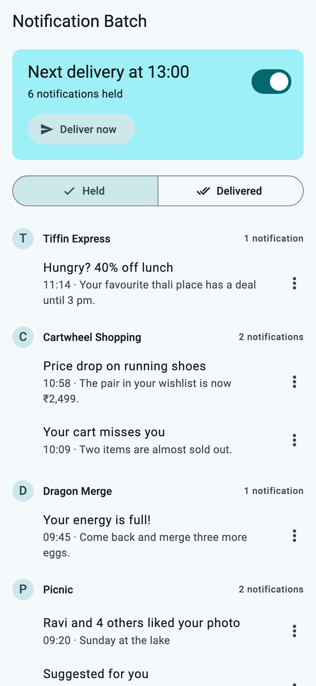
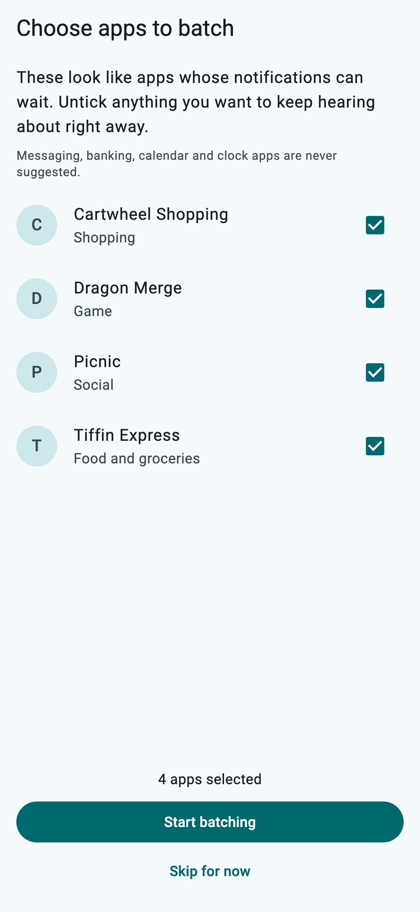
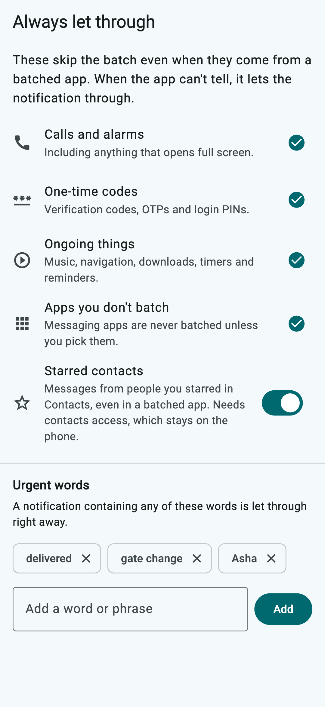
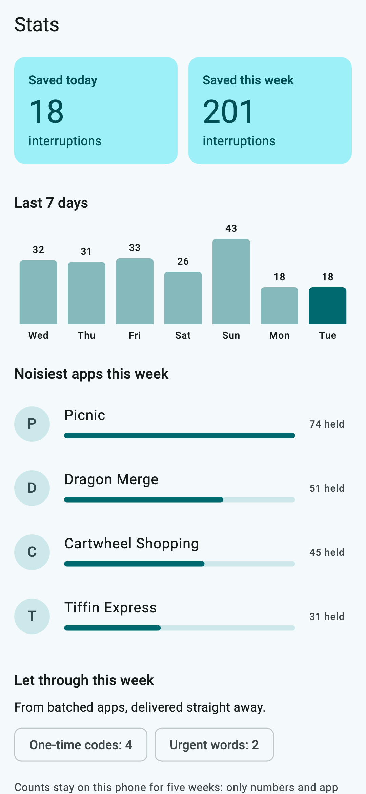
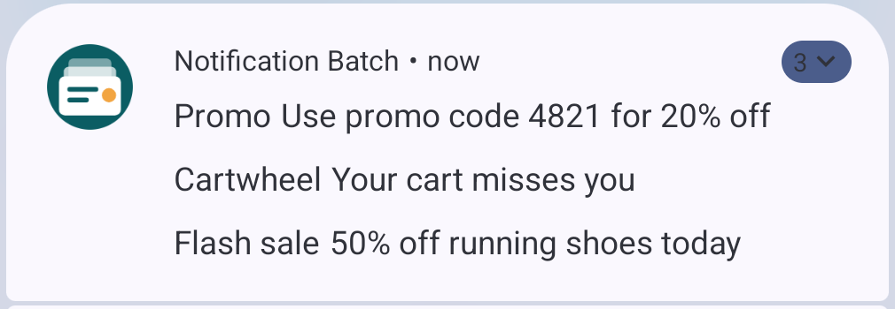
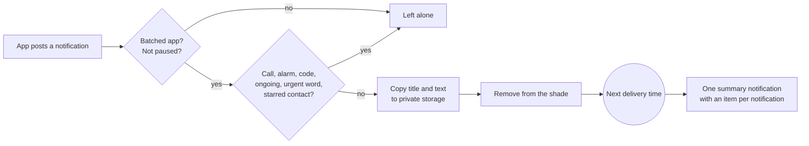

<div align="center">

# Notification Batch

**Fewer pings, nothing missed.** An Android app that holds notifications from the apps you pick
(shopping, food delivery, games, social feeds) and delivers them together a few times a day.
Calls, alarms, one-time codes and anything you mark as urgent still come through right away.

[](https://github.com/ChandraChaan/notification-batch/actions/workflows/ci.yml)
[](https://github.com/ChandraChaan/notification-batch/releases/latest)
[](LICENSE)







</div>

## Why

Most notifications are not urgent: a price drop, a lunch deal, "your energy is full". Each one
still lights up the screen and pulls you back to the phone. Turning them off means missing the
few that matter; leaving them on means dozens of interruptions a day.

Notification Batch sits in the middle. Pick the apps whose notifications can wait, choose when you
want to hear from them (say 9:00, 13:00 and 19:00), and get one quiet summary at those times
instead of a ping every few minutes.

## Download APK

Get the latest signed APK from the [**Releases page**](https://github.com/ChandraChaan/notification-batch/releases/latest):

| Your phone | File |
| --- | --- |
| Most phones from the last 6 years (64-bit) | [`notification-batch-arm64-v8a.apk`](https://github.com/ChandraChaan/notification-batch/releases/latest/download/notification-batch-arm64-v8a.apk) |
| Older 32-bit phones | [`notification-batch-armeabi-v7a.apk`](https://github.com/ChandraChaan/notification-batch/releases/latest/download/notification-batch-armeabi-v7a.apk) |
| Not sure | [`notification-batch-universal.apk`](https://github.com/ChandraChaan/notification-batch/releases/latest/download/notification-batch-universal.apk) (bigger, works everywhere) |

Each release has a `SHA256SUMS` file. To check a download:

```bash
sha256sum -c SHA256SUMS --ignore-missing
```

Needs Android 8.0 or later. Because the APK comes from GitHub and not an app store, Android 13
and later may say **"Restricted setting"** when you turn on notification access. Open
*Settings → Apps → Notification Batch*, tap the three-dot menu, choose **Allow restricted
settings**, and try again. The app walks you through this too.

## What it does

- **Batches the apps you choose.** On first run it suggests shopping, food delivery, game and
  social apps, all ticked so you can untick what you want to keep. It never suggests messaging,
  email, phone, banking, payment, calendar, clock or travel apps.
- **Delivers at your times.** One summary notification that expands to the held items. Tap an item
  to open what the original notification pointed at, or its app if Android no longer allows that.
  Items you don't open roll into the next batch.

  

  *A real batch on an Android emulator, from test notifications.*
- **Always lets through:**
  - calls, alarms and anything that opens full screen;
  - one-time codes (OTPs, verification codes, login PINs), see [the rule](#how-one-time-codes-are-spotted);
  - ongoing things: music, navigation, downloads, timers, reminders and calendar events;
  - messages from your starred contacts, if you turn that on;
  - anything with one of your **urgent words** (for example "delivered", "gate change" or a name).
    You can also mark a held item as urgent straight from the inbox.
- **Stats:** interruptions saved today and over the last seven days, a bar per day, the
  noisiest apps, and what was let through and why. Only counts and app names are kept, for five
  weeks.
- **Pause** with one switch, or **Deliver now** whenever you like.
- **An in-app inbox** shows what is held and what was delivered in the last two days.

When it can't tell, it lets the notification through. Missing something important is worse than
one extra ping.

## The permission, explained

To hold a notification, the app has to see it arrive. Android calls this **notification access**.
It is a powerful permission: an app with it can read the notifications on your phone. Here is
exactly what this app does with it:

- It looks at a notification only to decide whether it comes from an app you batch, and whether
  it must be let through.
- If it's held, the app keeps a copy of the **title and text** in its private storage and removes
  the notification from the shade. Nothing else is kept.
- Notifications from apps you don't batch are left alone.
- Turn access off in Android settings at any time and everything goes back to normal.

The app explains this on the first screen, before sending you to Android's settings.

Other permissions, all optional except the first:

| Permission | Why |
| --- | --- |
| Post notifications | To show the batch summary. |
| Alarms & reminders | To deliver right on time. Without it Android may be up to 10 minutes late. |
| Contacts | Only if you turn on "Starred contacts", to recognise who a message is from. |
| Run at startup | To set the next delivery again after a reboot. |

## Privacy

- **No internet permission.** The release APK cannot open a network connection, so nothing can
  leave your phone. You can check this yourself: `aapt dump permissions notification-batch-universal.apk`.
- No ads, no analytics, no crash reporting, no account.
- Held notifications are stored in the app's private storage and are excluded from cloud backup
  and device transfer. Delivered items are kept for two days so you can find them in the inbox.
- Stats are daily counts per app, kept for five weeks. They never include what a notification said.
- Uninstalling the app deletes everything it stored.

## How it works



- A Kotlin `NotificationListenerService` sees every notification. The decision is a pure function
  (`BatchPolicy`) with JVM unit tests, so it runs instantly and without the Flutter engine.
- Held items are written to a small JSON file before the notification is removed, so a crash can
  cause a duplicate but never a loss.
- An alarm fires at the next delivery time. If it was missed (phone off, app updated, system
  delay), the next notification or app start delivers the late batch.
- Delivery times follow the phone's clock through time zone and daylight saving changes: 13:00
  stays 13:00.
- The Flutter UI talks to Android through one Dart interface (`BatchPlatform`) over a method
  channel, which keeps the UI testable with a fake.

### How one-time codes are spotted

A notification is treated as a code when it has **both**:

1. something that looks like a code: 4 to 8 digits, `123 456`, `123-456` or `G-123456`, but not a
   price (`₹4999`), a date (`2026-10-27`), a time or part of a longer number like a phone number;
2. a word about it: *OTP, verification, verify, passcode, one-time, 2FA, login, sign in, PIN,
   security code, authentication*, a few non-English forms, or plain *code* when the text
   doesn't read like a promotion ("promo code", "20% off").

Android 15 and later may hide codes from apps like this one; the app treats that hidden text as a
code too. The rule and its edge cases are in
[`OtpDetector.kt`](android/app/src/main/kotlin/io/github/chandrachaan/notification_batch/core/OtpDetector.kt)
and [its tests](android/app/src/test/kotlin/io/github/chandrachaan/notification_batch/core/OtpDetectorTest.kt).
Spotted a code it missed? Please [open an issue](https://github.com/ChandraChaan/notification-batch/issues)
with the wording (replace the digits).

## Limits worth knowing

- A held item keeps its title and text, not its pictures, buttons or inline reply.
- Tapping a delivered item opens the original target while the app is running. After a restart
  Android no longer has it, so the item opens its app instead.
- Android shows at most 50 notifications per app, so a batch shows the newest 24 items in the
  shade; the rest are in the app's inbox.
- If you batch a messaging app, its messages wait like everything else unless they come from a
  starred contact or contain an urgent word.

## Build it yourself

Flutter 3.44 and JDK 17.

```bash
git clone https://github.com/ChandraChaan/notification-batch.git
cd notification-batch
flutter pub get
flutter run
```

Checks, as run by CI:

```bash
dart format --output=none --set-exit-if-changed .
flutter analyze
flutter test
(cd android && ./gradlew :app:testDebugUnitTest)
```

The README screenshots are rendered from the real widgets with made-up data:
`flutter test tool/screenshots_test.dart --update-goldens`.

Release builds are signed with a key in `android/key.properties` (not in the repository).
Without it, `flutter build apk --release` produces an unsigned APK.

## Project layout

```text
lib/
  core/platform/        Dart interface to Android and its method channel implementation
  features/
    inbox/              Held and delivered items, next delivery, pause, deliver now
    apps/               App picker and the suggestion rules
    schedule/           Delivery times
    rules/              What is always let through
    stats/              Interruptions saved, noisiest apps
    onboarding/         Permission explanation and first-run app picker
android/app/src/main/kotlin/io/github/chandrachaan/notification_batch/
  core/                 Pure Kotlin: policy, code detection, schedule, stores
  platform/             Listener service, alarms, batch notification, channel bridge
spec/settings.json      Settings format shared by the Dart and Kotlin tests
```

## Contributing

Issues and pull requests are welcome. Please read [AGENTS.md](AGENTS.md) for the project rules,
and add a test for any change to what gets held or let through.

## License

[MIT](LICENSE) © Chandra ObulaReddy
